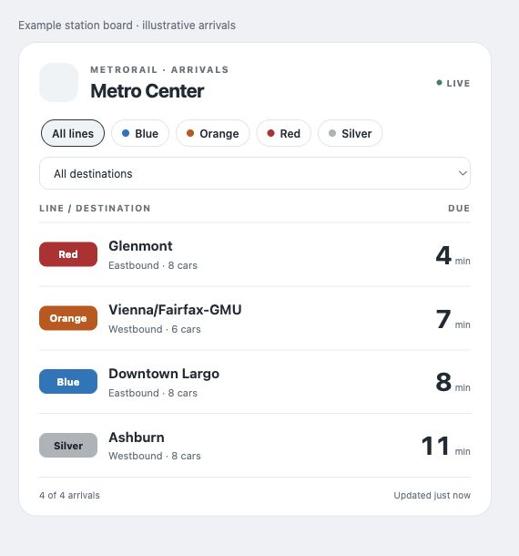
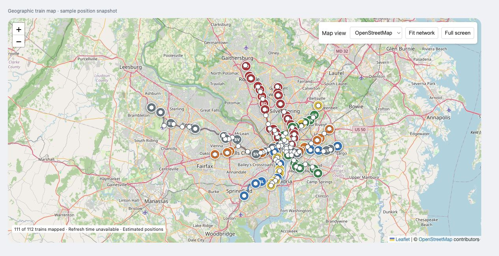

# WMATA for Home Assistant

Live Metrorail and Metrobus arrival boards, saved journeys for automations, and an interactive train map.

**Requires Home Assistant 2026.11.1 or newer.** Both dashboard cards and their JavaScript dependencies are bundled.

**Upgrading from 2.x?** Version 4 replaces numbered train/bus sensors with one board per location. Read the [upgrade guide](docs/UPGRADING.md) first.

## Quick start

### 1. Get an API key

1. Create a [WMATA developer account](https://developer.wmata.com/).
2. Subscribe to a product covering the APIs you want to use.
3. Copy its subscription key from your developer profile.

Creating an account alone does not activate API access. Setup checks access to the selected service and reports an error while you can still edit the key.

| Feature | Required APIs |
| --- | --- |
| Rail boards | Rail Station Information and Real-Time Rail Predictions |
| Bus boards | Bus Route and Stop Methods and Real-Time Bus Predictions |
| Train map | Train Positions, including Standard Routes and Track Circuits |
| Station popups on the map | Real-Time Rail Predictions |

### 2. Install

**HACS**

Open HACS → menu → Custom repositories. Add this repository URL, select category Integration, download WMATA, and restart HA.

https://github.com/benlikethecolor/HomeAssistant-WMATA

[Open repository in HACS](https://my.home-assistant.io/redirect/hacs_repository/?owner=benlikethecolor&repository=HomeAssistant-WMATA&category=integration)

**Manual installation**

Copy custom_components/wmata into your HA configuration's custom_components directory. The resulting path must include custom_components/wmata/manifest.json. Restart HA.

If using the release ZIP, extract it into the HA configuration directory and retain its custom_components/wmata directory structure.

### 3. Choose a service

Open **Settings → Devices & services → Add integration → WMATA**. Enter the key and choose:

| Service | Next input | Created in HA |
| --- | --- | --- |
| Metrorail | Station name/code | Station device with an Arrivals sensor |
| Metrobus | Seven-digit stop ID from the stop sign | Stop device with an Arrivals sensor |
| Systemwide train map | Completes after validation | WMATA network device with a Trains sensor |

Find a seven-digit bus stop ID using [WMATA busETA](https://buseta.wmata.com/) or the number printed on the stop sign.

Add another entry for each additional station or stop. You can reuse the same key. One network entry covers the systemwide map.

Transfer stations automatically include both platform codes. Either code works. A [station code reference](docs/METRO_STATION_CODES.md) is also available.

### 4. Add a card

Refresh the browser after restarting HA. Edit a dashboard, select Add card, and search for **WMATA Station Board** or **WMATA train map**.

Choose the entity by its displayed name in the editor. Cards load automatically. No separate card repository or resource entry is needed.

## Arrival boards

Each station/stop has one sensor. Its numeric state is minutes until the next arrival. Its arrivals attribute contains the complete ordered list.

~~~yaml
type: custom:wmata-station-card
entity: sensor.wmata_k01_arrivals
max_rows: 8
~~~

The card editor exposes title, row count, appearance and visibility options. Interactive line/route and destination filters retain selections during updates and reset on a page reload. For permanent filters:

~~~yaml
type: custom:wmata-station-card
entity: sensor.wmata_k01_arrivals
title: Silver to Ashburn
lines: [SV]
destinations: [N12]
max_rows: 5
show_filters: false
show_updated: true
~~~

| Option | Default | Values |
| --- | --- | --- |
| entity | Required | Board or saved journey sensor |
| title | Station/journey name | Custom heading |
| max_rows | 8 | Integer, 1–30 |
| show_filters | true | Interactive filtering controls |
| show_updated | true | Display update age |
| appearance | standard | standard, daylight, orbit, bento |
| lines | All | Rail codes, e.g. [BL, SV] |
| routes | All | Bus route IDs, e.g. [D34] |
| destinations | All | Exact API destination codes, e.g. [N12] |

Appearance presets style this card independently of any personal dashboard layout.

| State | Meaning |
| --- | --- |
| Number | Minutes until the next predicted arrival |
| 0 | Arriving, boarding, or an API estimate of zero minutes |
| unknown | No numeric prediction is available |
| unavailable | The request failed or the entry has not loaded |

Rows retain arriving, boarding, delayed and Last train labels. Destination names are expanded when WMATA supplies a recognizable station code or abbreviation. Missing destinations remain unavailable.

## Saved journeys and automations

1. Add the station or stop as a WMATA entry.
2. Open its **Configure → Add a journey**.
3. Name it, such as Silver to Ashburn.
4. Select lines, train termini and optional travel direction, or bus routes and direction.
5. Save, then find its sensor on the station/stop device.

The sensor's numeric value is minutes until the next matching arrival. Subsequent matching arrivals remain in its attributes. Edit and remove journeys through Configure. Renaming preserves identity. Removing a journey removes its entity.

Empty filters accept all values. Multiple selections within a filter use OR. Populated filters combine with AND. Rail rows show station-specific travel directions, such as Eastbound or Northbound. These follow the route toward the next station, including branch changes, rather than the prediction group number. See the [station direction reference](docs/RAIL_DIRECTIONS.md). Unknown or terminating directions are left unavailable.

**Choose the train's terminus.** An arbitrary intermediate station does not determine whether a train will stop there. For westbound Silver trains terminating at Ashburn, choose Ashburn.

Bus routes are comma-separated IDs. Both direction 0 and direction 1 are valid. Inspect the stop board's direction and direction_id attributes to identify the direction you need.

In an automation's Numeric state entity picker, search for the station or journey by name. Below 6 fires when its value enters that numeric range. To check trains when you leave home, use leaving home as the trigger and the ETA as a condition.

Replace the entity and notification action in this example with yours:

~~~yaml
alias: Silver train approaching
triggers:
  - trigger: numeric_state
    entity_id: sensor.wmata_court_house_silver_to_ashburn
    below: 6
actions:
  - action: notify.mobile_app_your_phone
    data:
      message: A matching Silver Line train is within five minutes.
mode: single
~~~

Find the actual ID in the entity picker or Settings → Devices & services → WMATA → the station device → Entities. HA can retain a customized ID.

The map's Trains sensor counts reported network trains. For arrival automations at a station viewed on the map, add a station entry and optional journey.

## Live train map

Add a Systemwide train map entry, then add the WMATA train map card:

~~~yaml
type: custom:wmata-train-map
entity: sensor.wmata_network_trains
view: geographic
theme_mode: auto
height: 850
~~~

OpenStreetMap is the default. Map view switches to the official diagram. Click a train for its full line name, destination, service and circuit details. Click a station for upcoming arrivals across all its platforms. Station popups refresh while open and work without separate station entries.

Zoom, Fit network, full screen and drag-resize controls are included. Last refreshed records the latest successful network request in your browser's local time.

| Option | Default | Values |
| --- | --- | --- |
| entity | Automatically suggested | Network Trains sensor |
| view | geographic | geographic or diagram |
| theme_mode | auto | auto, dark or light |
| dark_mode | Unset | Optional boolean override of theme_mode |
| height | 750 | Pixels, 250–1600 |
| zoom | 1 | Diagram zoom, 1–4 |
| tile_url | OSM tiles | Alternate tile-provider template |
| tile_attribution | OSM attribution | Attribution required by your provider |

Use theme_mode: dark to force dark mode, or view: diagram to open the official map by default.

Positions are estimates interpolated by circuit order along route geometry. Circuit lengths are not supplied by the feed. Connected side tracks are represented near the closest mapped circuit. The coverage count includes trains without locatable circuits.

The basemap uses OSM tiles. Rail geometry comes from WMATA's public GIS data. Leaflet and geometry are bundled locally. Geographic tiles require access to the selected provider. WMATA keys stay in HA. See [map data sources](custom_components/wmata/GEO_SOURCES.md).

## Polling and credentials

Configure → Polling settings controls each entry's interval, default 30 seconds, range 15–300 seconds. Journeys share their station's polling, and cards share their entry's data. Station popups fetch on demand with a shared 30-second cache.

Entries using the same key share pacing, station-catalog caching and rate-limit cooldowns. Increase intervals if tracking many locations or sharing a key with other apps.

Use Reconfigure to change a key. Invalid keys trigger reauthentication. Frequently changing arrival arrays, map geometry and timestamps are excluded from recorder attribute history but remain available in live state and templates.

## Troubleshooting

| Problem | Check |
| --- | --- |
| WMATA missing from Add integration | Folder path, minimum HA version, and restart |
| API key rejected | Active subscription covering the required service APIs |
| Unknown card type | Refresh the browser and check Settings → System → Logs for setup failures |
| Old manually added card resource | Remove obsolete WMATA resources, refresh, and use automatic card loading |
| Empty board | Service hours, station/stop code and card filters |
| Unknown journey | Match its filters against the live board attributes |
| Blank basemap with visible routes | Browser access to the tile provider |
| Some trains have no marker | Reported circuits may be absent from available geometry |
| Unavailable sensors | Connection, rate-limit or subscription errors in HA logs |

Logs use custom_components.wmata. Include your HA/integration versions, service type, station/stop code and relevant errors when reporting problems. Remove credentials before sharing files.

## Development

See the [4.6.3 changes and validation](docs/RELEASE_NOTES_4_6_3.md) and [4.6.2 verification report](docs/RELEASE_VERIFICATION.md) for completed checks and the remaining HACS check.

See [development and release verification](docs/DEVELOPMENT.md) for tests, reproducible geometry generation and packaging.

WMATA provides the transit data. Thanks to [walrus416](https://github.com/walrus416/ha-wmata) for the original inspiration and [msp1974](https://github.com/msp1974/HAIntegrationExamples) for integration examples.
